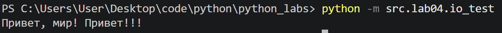
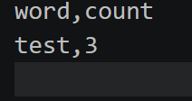
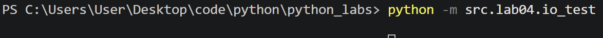
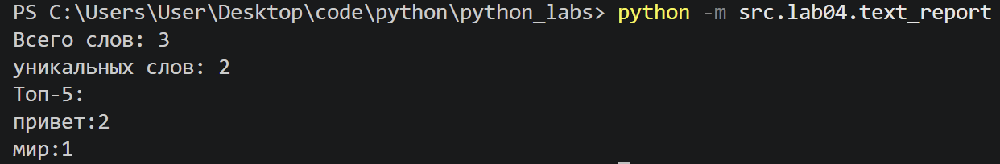
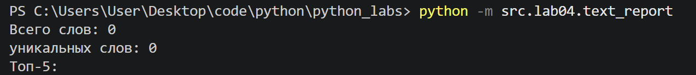
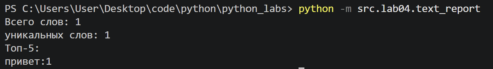

# ЛР4 — Файлы: TXT/CSV и отчёты по текстовой статистике
## Задание A
### read_text
Функция принимает путь к файлу в виде строки или объекта Path. При помощи .read_text() файл открывается, для декодирования по умолчанию используется UTF-8. Ошибки отсутствия файла FileNotFoundError или несовпадения кодировки UnicodeDecodeError намеренно не перехватываются. 
```python
from pathlib import Path 

def read_text(path: str | Path, encoding = "utf-8") -> str:
    '''
    Reads text file and returns its contents as a single string.
    UTF-8 encoding is used by default. 
    A different encoding can be specified as: read_text("name_of_a_file.txt", encoding="cp1251").
    Raises:
        FileNotFoundError: if the file does not exist.
        UnicodeDecodeError if the file cannot be decoded with the specified encoding.
    '''
    p = Path(path)
    return p.read_text(encoding=encoding)
```

### ensure_parent_dir
Функция принимает путь к файлу в виде строки или объекта Path. Метод mkdir() создаёт недостающие родительские директории благодаря parents=True. Параметр exist_ok=True позволяет избежать ошибки, если директория уже существует.
```python
def ensure_parent_dir(path: str | Path) -> None:
    '''
    Creates parent directories for the specified path
    if they do not already exist.
    '''
    p = Path(path)
    p.parent.mkdir(parents = True, exist_ok = True)
```

### write_csv
Функция принимает на вход данные для записи, путь к файлу и необязательный заголовок. Путь преобразуется в объект Path, данные - в список. Строки проверяются на равенство длин, если условие нарушено, вызывается ValueError. Далее создаются необходимые директории, файл открывается в режиме записи с кодировкой UTF-8, и с помощью csv.writer() последовательно записываются заголовок и строки данных.
```python
from typing import Iterable, Sequence
import csv

def write_csv(rows: Iterable[Sequence], path: str | Path,
              header: tuple[str, ...] | None = None) -> None:
    """
    Writes data to a CSV file using UTF-8 encoding.
    Checks that all rows have the same length.
    Raises ValueError if row lengths do not match.
    """
    p = Path(path)
    rows = list(rows)

    if rows:
        row_len = len(rows[0])
        for row in rows:
                if len(row) != row_len:
                    raise ValueError("All rows must have same length")
        if header is not None:
            if len(header) != row_len:
                raise ValueError("Header and rows must have same length")
        
    ensure_parent_dir(path)
    with p.open("w", newline="", encoding="utf-8") as f:
        w = csv.writer(f)
        if header is not None:
            w.writerow(header)
        for r in rows:
            w.writerow(r)
```

## Тесты для задания A
\
\
*базовый тест*
\
*пустой файл*
\
*отсутствие файла*

## Задание B
Функция sorted_word_counts() сортирует слова по убыванию частоты, а при одинаковой частоте — по алфавиту. Функция main() считывает текст из файла, обрабатывая ошибку его отсутствия, затем нормализует текст, разбивает его на слова и подсчитывает их частоты. Полученные данные сортируются и записываются в CSV-файл с заголовком. После этого в консоль выводятся общее количество слов, количество уникальных слов и топ-5 наиболее частых слов.
```python
from src.lib.text import normalize, tokenize, count_freq, top_n
from src.lab04.io_txt_csv import read_text, write_csv
import sys

def sorted_word_counts(freq: dict[str, int]) -> list[tuple[str, int]]:
    return sorted(freq.items(), key=lambda kv: (-kv[1], kv[0]))

def main():
    input_path = 'data/lab4/input.txt'
    output_path = 'data/lab4/report.csv'
    try:
        text = read_text(input_path, encoding="utf-8")
    except FileNotFoundError:
        print(f"Файл не найден: {input_path}", file=sys.stderr)
        sys.exit(1)

    normal = normalize(text)
    tokens = tokenize(normal)
    freq = count_freq(tokens)
    rows = sorted_word_counts(freq)
    write_csv(rows, output_path, header = ("word", "count"))

    print(f'Всего слов: {len(tokens)}')
    print(f'уникальных слов: {len(freq)}')
    print('Топ-5:')
    for w, c in top_n(freq, 5):
        print(f'{w}:{c}')

if __name__ == "__main__":
    main()

```

## Тесты для задания B
\
*базовый тест*

Если входной TXT-файл пустой, программа выводит нулевое количество всех и уникальных слов, а список топ-5 остаётся пустым. При этом создаётся CSV-файл, содержащий только заголовок word,count.
\
*пустой файл*

По умолчанию для чтения TXT-файлов и записи CSV используется кодировка UTF-8. Для чтения другой кодировки необходимо изменить параметр encoding при вызове функции.
При несоответствии кодировки содержимому файла возможно возникновение UnicodeDecodeError.\

*тест с кодировкой cp1251 (text = read_text(input_path, encoding="cp1251"))*

Для запуска задания B из корневой директории проекта используется команда:``python -m src.lab04.text_report``

Если входной файл отсутствует, программа выводит сообщение File not found и завершается с кодом ошибки 1.\
При обработке больших файлов допускается считывание всего содержимого целиком, однако на практике для экономии оперативной памяти предпочтительно построчное чтение.