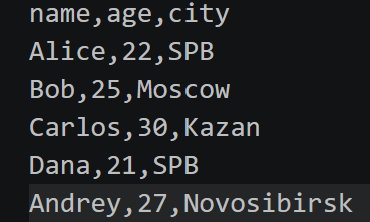
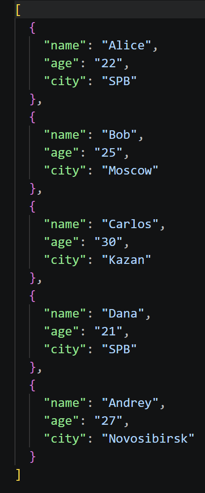
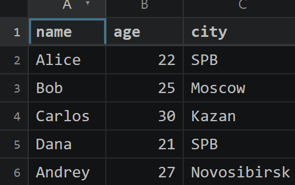

# ЛР5 — JSON и конвертации (JSON↔CSV, CSV→XLSX)
## Задание A — JSON ↔ CSV

```python
import json
import csv 
from pathlib import Path

def json_to_csv(json_path: str, csv_path: str) -> None:
    """
    Преобразует JSON-файл в CSV.
    Поддерживает список словарей [{...}, {...}], заполняет отсутствующие поля пустыми строками.
    Кодировка UTF-8. Порядок колонок — как в первом объекте или алфавитный (указать в README).
    """

    json_p = Path(json_path)

    if not json_p.is_file():
        raise FileNotFoundError("File not found")
    if json_p.suffix.lower() != ".json": 
        raise ValueError("File must have .json extension")

    with json_p.open("r", encoding="utf-8") as file:
        try:
            data = json.load(file)
        except json.JSONDecodeError as e:
            raise ValueError(f"Invalid JSON: {e.msg}, line {e.lineno}, column {e.colno}") from e

    if not isinstance(data, list):
        raise ValueError("JSON must contain a list")
    if not data:
        raise ValueError("JSON list must not be empty")
    for di in data:
        if not isinstance(di, dict):
            raise ValueError("Data's components must be dictionaries")
        for key in di.keys():
            if not isinstance(key, str):
                raise ValueError("Dictionaries' keys must be strings")
    fieldnames = []

    for di in data:
        for key in di:
            if key not in fieldnames:
                fieldnames.append(key)
    if not fieldnames:
        raise ValueError("Dictionary does not contain keys")

    csv_p = Path(csv_path)
    if csv_p.suffix.lower() != ".csv":
            raise ValueError("Output file must have .csv extension")
    
    csv_p.parent.mkdir(parents = True, exist_ok = True)
  
    with csv_p.open("w", newline="", encoding="utf-8") as file:
        writer = csv.DictWriter(file, fieldnames=fieldnames, restval="")
        writer.writeheader()
        writer.writerows(data)


def csv_to_json(csv_path: str, json_path: str) -> None:
    """
    Преобразует CSV в JSON (список словарей).
    Заголовок обязателен, значения сохраняются как строки.
    json.dump(..., ensure_ascii=False, indent=2)
    """
    
    csv_p = Path(csv_path)

    if not csv_p.is_file():
        raise FileNotFoundError("File not found")
    if csv_p.suffix.lower() != ".csv":
        raise ValueError("File must have .csv extension")

    with csv_p.open("r", newline="", encoding="utf-8") as file:
        reader = csv.DictReader(file)
        fieldnames = reader.fieldnames
        if not fieldnames:
            raise ValueError("CSV must contain headers")
        if any(not name or not name.strip() for name in fieldnames):
            raise ValueError("CSV headers must not be empty")
        if len(fieldnames) != len(set(fieldnames)):
            raise ValueError("CSV headers must be unique")

        rows =  list(reader)

    if not rows:
        raise ValueError("CSV must contain at least one data row")

    json_p = Path(json_path)

    if json_p.suffix.lower() != ".json":
            raise ValueError("Output file must have .json extension")
    json_p.parent.mkdir(parents = True, exist_ok = True)
    

    with json_p.open("w", encoding="utf-8") as file:
        json.dump(rows, file, ensure_ascii=False, indent=2)    
```

### Преобразование `people.json` в `people_from_json.csv`:
```python
python -c "from src.lab05.json_csv import json_to_csv; json_to_csv('data/samples/people.json', 'data/out/people_from_json.csv')" 
```


### Преобразование `people.csv` в `people_from_csv.json`:
```python
python -c "from src.lab05.json_csv import csv_to_json; csv_to_json('data/samples/people.csv', 'data/out/people_from_csv.json')"  
```



## Задание B — CSV → XLSX
```python
import csv
from pathlib import Path
from openpyxl import Workbook
from openpyxl.utils import get_column_letter

def csv_to_xlsx(csv_path: str, xlsx_path: str) -> None:
    """
    Конвертирует CSV в XLSX.
    Использовать openpyxl ИЛИ xlsxwriter.
    Первая строка CSV — заголовок.
    Лист называется "Sheet1".
    Колонки — автоширина по длине текста (не менее 8 символов).
    """

    csv_p = Path(csv_path)
    if not csv_p.is_file():
        raise FileNotFoundError("File not found")
    if csv_p.suffix.lower() != ".csv":
        raise ValueError("File must have .csv extension")

    with csv_p.open("r", newline="", encoding="utf-8") as file:
        reader = csv.reader(file)
        rows = list(reader)

    if not rows:
        raise ValueError("CSV file is empty")
    headers = rows[0]
    if not headers or any(not name.strip() for name in headers):
        raise ValueError("CSV headers must not be empty")
    if len(headers) != len(set(headers)):
        raise ValueError("CSV headers must be unique")
    if len(rows) < 2:
        raise ValueError("CSV must contain at least one data row")
    for row in rows:
        if len(row) != len(headers):
            raise ValueError("CSV file contains rows with missing or extra fields")

    wb = Workbook()
    ws = wb.active
    ws.title = "Sheet1"

    for row in rows:
        ws.append(row)

    for column in ws.columns:
        max_length = max(len(str(cell.value)) if cell.value is not None else 0 for cell in column)
        width = max(8, max_length + 2)

        letter = get_column_letter(column[0].column)
        ws.column_dimensions[letter].width = width

    xlsx_p = Path(xlsx_path)
    if xlsx_p.suffix.lower() != ".xlsx":
            raise ValueError("Output file must have .xlsx extension")
    
    xlsx_p.parent.mkdir(parents=True, exist_ok=True)
 

    wb.save(xlsx_p)
```

### Создание `people.xlsx` из `people.csv`
```python
python -c "from src.lab05.csv_xlsx import csv_to_xlsx; csv_to_xlsx('data/samples/people.csv', 'data/out/people.xlsx')"   
```
