# ЛР6 — CLI‑утилиты с argparse (cat/grep‑lite + конвертеры)
## Задание A
Для создания интерфейса командной строки используется стандартный модуль argparse. Программа cli_text.py поддерживает две подкоманды: cat для вывода содержимого файла и stats для анализа частот слов.
Для каждой подкоманды определяются отдельные аргументы. После обработки аргументов с помощью parse_args() вызывается соответствующая функция.
```py
import argparse
from pathlib import Path

from src.lib.text_stats import get_text_stats
```

### cat_command
Функция принимает путь к текстовому файлу и необязательный параметр numbered, определяющий необходимость нумерации строк. С помощью Path проверяется существование входного файла. Далее файл открывается в кодировке UTF-8, а его содержимое выводится построчно.
При включённом флаге -n используется enumerate(file, start=1), позволяющий нумеровать строки начиная с единицы. Для предотвращения лишних переносов строк применяется print(..., end="").
```py
def cat_command(input_path: str, numbered: bool = False) -> None:
    path = Path(input_path)

    if not path.is_file():
        raise FileNotFoundError("File not found")

    with path.open("r", encoding="utf-8") as file:
        for number, line in enumerate(file, start = 1):
            if numbered:
                print(f"{number} {line}", end="")
            else:
                print(line, end="")
```
### stats_command
Функция принимает путь к текстовому файлу и параметр top, определяющий количество наиболее частых слов. По умолчанию top=5.
После проверки существования файла его содержимое считывается в кодировке UTF-8. Для анализа используется функция, объединяющая нормализацию текста, токенизацию, подсчёт частот и выбор наиболее распространённых слов.
Результатом является вывод общего количества слов, количества уникальных слов и списка наиболее частых слов с их частотами.
```py
def stats_command(input_path: str, top: int = 5) -> None:
    path = Path(input_path)

    if not path.is_file():
        raise FileNotFoundError("File not found")

    with path.open("r", encoding="utf-8") as file:
        text = file.read()

    total, unique, top_words = get_text_stats(text, top)

    print(f'Всего слов: {total}')
    print(f'Уникальных слов: {unique}')
    print(f'Топ-{top}:')

    for w, c in top_words:
        print(f'{w}: {c}')
```
### main
Основная функция main() создаёт ArgumentParser, регистрирует подкоманды через add_subparsers() и определяет необходимые аргументы с помощью add_argument().
Для cat обязательным является аргумент --input, а флаг -n включает нумерацию строк.
Для stats обязательным является --input, а необязательный аргумент --top определяет количество наиболее частых слов. Дополнительно проверяется, что его значение больше нуля.
Выбор выполняемой операции происходит по значению args.command.
```py
def main():
    parser = argparse.ArgumentParser(
        description="CLI utilities for text processing"
    )
    
    subparsers = parser.add_subparsers(dest = "command", required=True)

    cat_parser = subparsers.add_parser("cat", help="Print file contents")
    cat_parser.add_argument("--input", required=True, help="Path to input file")
    cat_parser.add_argument("-n", action="store_true", help="Print line numbers")

    stats_parser = subparsers.add_parser("stats", help="Show word frequencies")
    stats_parser.add_argument("--input", required=True, help="Path to input text file")
    stats_parser.add_argument("--top", type=int, default=5, help="Number of most frequent words")

    args = parser.parse_args()

    if args.command == "stats" and args.top < 1:
        parser.error('--top must be greater than zero')

    try: 
        if args.command == "cat":
            cat_command(args.input, args.n)
        elif args.command == "stats":
            stats_command(args.input, args.top)

    except FileNotFoundError:
        parser.error(f"File not found: {args.input}")
    except UnicodeDecodeError:
        parser.error(f'File {args.input} cannot be read using UTF-8 encoding')

if __name__ == "__main__":
    main()
```
### Запуск
```bash
python -m src.lab06.cli_text cat --input data/samples/people.csv
```
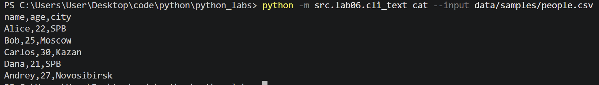
*Вывод содержимого файла*\
```bash
python -m src.lab06.cli_text cat --input data/samples/people.csv -n
```
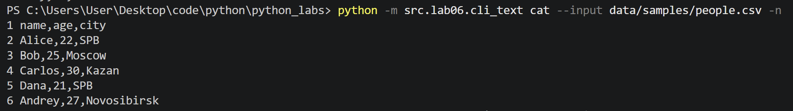
*Вывод содержимого файла с нумерацией строк*\
```bash
python -m src.lab06.cli_text stats --input data/samples/people.txt --top 5
```
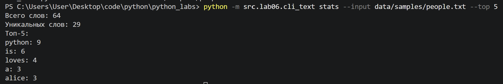
*Анализ частот слов, выведен топ-5*\
```bash
python -m src.lab06.cli_text stats --input data/samples/people.txt --top 3
```
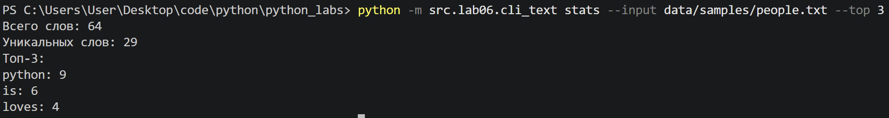
*Анализ частот слов, выведен топ-3*

## Задание B
Программа cli_convert.py предоставляет интерфейс командной строки для функций конвертации, реализованных в ЛР5.
С помощью argparse определяются три подкоманды, каждая подкоманда принимает два обязательных аргумента: --in для указания исходного файла и --out для указания выходного файла.
Параметр dest="input" позволяет обращаться к значению аргумента --in через args.input, поскольку in является ключевым словом Python.
После обработки аргументов программа определяет выбранную подкоманду и вызывает соответствующую функцию из ЛР5.

```py
import argparse
from src.lab05.json_csv import json_to_csv, csv_to_json
from src.lab05.csv_xlsx import csv_to_xlsx

def main():
    parser = argparse.ArgumentParser(description="Data converters)
    sub = parser.add_subparsers(dest="command", required=True)

    json_parser = sub.add_parser("json2csv", help="Convert a JSON file to CSV format.")
    json_parser.add_argument("--in", dest="input", required=True, help="Path to the input JSON file.")
    json_parser.add_argument("--out", dest="output", required=True, help="Path to the output CSV file.")

    csv_parser = sub.add_parser("csv2json", help="Convert a CSV file to JSON format.")
    csv_parser.add_argument("--in", dest="input", required=True, help="Path to the input CSV file.")
    csv_parser.add_argument("--out", dest="output", required=True, help="Path to the output JSON file.")

    xlsx_parser = sub.add_parser("csv2xlsx", help="Convert a CSV file to XLSX format.")
    xlsx_parser.add_argument("--in", dest="input", required=True, help="Path to the input CSV file.")
    xlsx_parser.add_argument("--out", dest="output", required=True, help="Path to the output Excel XLSX file.")

    args = parser.parse_args()

    try:
        if args.command == "json2csv":
            json_to_csv(args.input, args.output)
        elif args.command == "csv2json":
            csv_to_json(args.input, args.output)
        elif args.command == "csv2xlsx":
            csv_to_xlsx(args.input, args.output)
    except FileNotFoundError:
        parser.error(f"File not found: {args.input}")
    except ValueError as error:
        parser.error(str(error))

if __name__ == "__main__":
    main()
```

### Запуск
```bash
python -m src.lab06.cli_convert json2csv --in data/samples/people.json --out data/out/lab06/people_from_json.csv
```
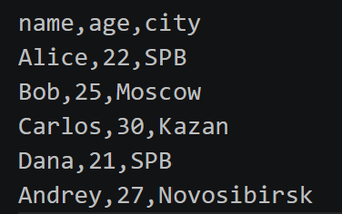\
*json2csv*\
```bash
python -m src.lab06.cli_convert csv2json --in data/samples/people.csv --out data/out/lab06/people_from_csv.json
```
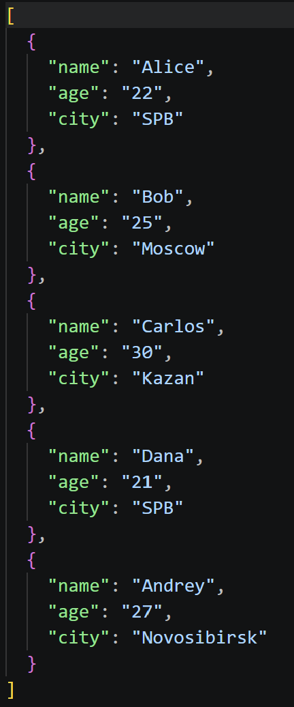\
*csv2json*\
```bash
python -m src.lab06.cli_convert csv2xlsx --in data/samples/people.csv --out data/out/lab06/people.xlsx
```
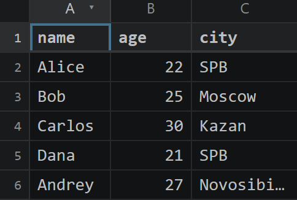\
*csv2xlsx*

## Проверка справки --help
### cli_text
```bash
python -m src.lab06.cli_text --help
```
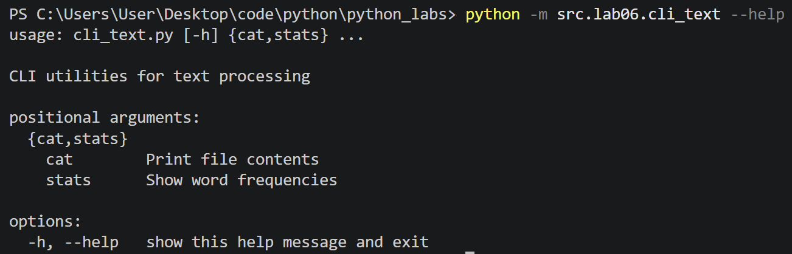
```bash
python -m src.lab06.cli_text cat --help
```
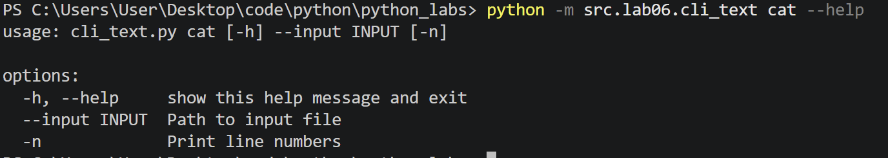
```bash
python -m src.lab06.cli_text stats --help
```
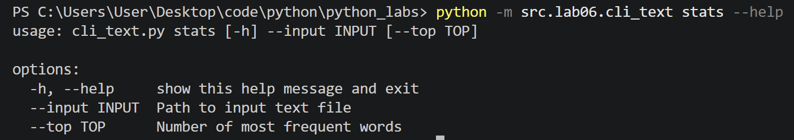

### cli_convert
```bash
python -m src.lab06.cli_convert --help
```
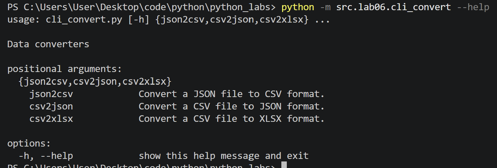
```bash
python -m src.lab06.cli_convert json2csv --help
```
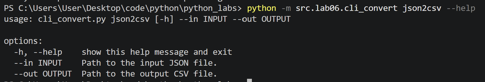

## Обработка ошибок
### cli_text
    FileNotFoundError — входной файл не существует.
    UnicodeDecodeError — невозможно декодировать содержимое файла с использованием UTF-8.
    parser.error() — аргумент --top имеет недопустимое значение или пользователь неправильно указал параметры команды.

Проверка отрицательного значения --top:
```bash
python -m src.lab06.cli_text stats --input data/samples/people.txt --top -3
```
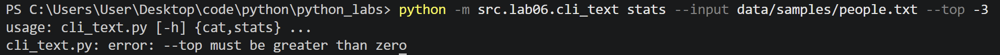
Проверка отсутствующего файла:
```bash
python -m src.lab06.cli_text cat --input missing.txt
```
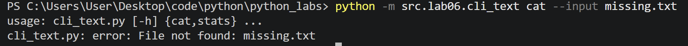

### cli_convert
    FileNotFoundError — исходный файл не найден.
    ValueError — некорректное расширение файла или неправильная структура входных данных.
    parser.error() — пользователь не передал обязательные аргументы или ввёл некорректную подкоманду.

Проверка отсутствия обязательных аргументов:
```bash
python -m src.lab06.cli_convert json2csv
```
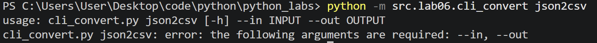