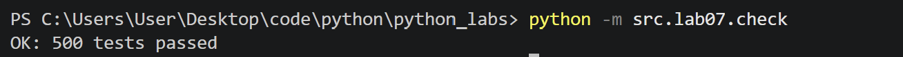
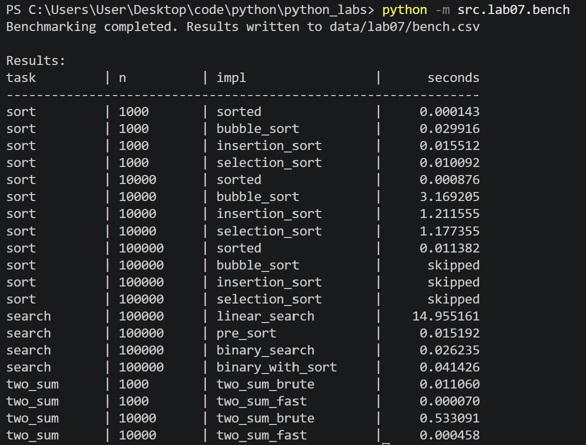

# ЛР7 — Поиск, сортировка и измерение времени
## Задание A - search.py

### linear_search
Функция последовательно перебирает элементы списка, сравнивает их с искомым числом. Возвращает индекс первого вхождения или -1, если число не найдено.
**Сложность: O(n)**
```py
def linear_search(nums, x):
    '''Returns the index of x, or -1.'''
    for i, num in enumerate(nums):
        if num == x:
            return i
    return -1
```

### binary_search
Функция ищет число в отсортированном списке, при каждом проходе уменьшая область поиска вдвое. Возвращает индекс элемента или -1.
**Сложность: O(log n)**
```py
def binary_search(sorted_nums, x):
    """
    Returns the index of x, or -1.
    The list must be sorted in ascending order.
    For an unsorted list, the result is undefined.
    """
    lo, hi = 0, len(sorted_nums) - 1
    while lo <= hi:
        mid = (lo + hi) // 2
        if sorted_nums[mid] == x:
            return mid
        elif sorted_nums[mid] < x:
            lo = mid + 1
        elif sorted_nums[mid] > x:
            hi = mid - 1
    return -1
```

### two_sum_brute
Функция ищет пару чисел с заданной суммой при помощи двух вложенных циклов. Возвращает индексы элементов в кортеже или None.
**Сложность: O(n^2)**
```py
def two_sum_brute(nums, target):
    '''
    Returns a tuple of indices (i, j) such that nums[i] + nums[j] == target, 
    or None if no such pair exists.
    Use a brute-force approach with O(n^2) time complexity.
    '''
    for i in range(len(nums) - 1):
        for j in range(i + 1, len(nums)):
            if nums[i] + nums[j] == target:
                return i, j
    return None
```

### two_sum_fast 
Функция ищет пару чисел с заданной суммой за один проход, сохраняя уже просмотренные числа и индексы в словарь. Возвращает индексы элементов в кортеже или None.
**Сложность: O(n)**
```py
def two_sum_fast(nums, target):
    '''
    Returns a tuple of indices (i, j) such that nums[i] + nums[j] == target, or None if no such pair exists.
    Use a hash map approach with O(n) time complexity.
    '''
    complements = {}
    for j in range(len(nums)):
        complement = target - nums[j]
        if complement in complements:
            i = complements[complement]
            return i, j
        complements[nums[j]] = j
    return None
```

## Задание B - sorting.py

### bubble_sort
Функция сравнивает соседние элементы, меняя их местами при необходимости; повторяет действие до завершения сортировки. 
**Сложность: O(n^2) в худшем случае, O(n) для отсортированного списка с ранним выходом**
```py
def bubble_sort(nums):
    '''
    Sorts a list of numbers in ascending order using the bubble sort algorithm.
    Returns the sorted list.
    '''
    nums = list(nums)
    n = len(nums)

    for i in range(n - 1):
        swapped = False

        for j in range(n - i - 1):
            if nums[j] > nums[j + 1]:
                nums[j], nums[j + 1] = nums[j + 1], nums[j]
                swapped = True

        if not swapped:
            break
    return nums
```

### insertion_sort
Функция последовательно берет элементы, вставляя их на нужное место в уже отсортированной части списка.
**Сложность: O(n^2) в худшем случае, O(n) для отсортированного списка**
```py
def insertion_sort(nums):
    '''
    Sorts a list of numbers in ascending order using the insertion sort algorithm.
    Returns the sorted list.
    '''
    nums = list(nums)
    for i in range(1, len(nums)):
        key = nums[i]
        j = i - 1

        while j >= 0 and nums[j] > key:
            nums[j + 1] = nums[j]
            j -= 1

        nums[j + 1] = key
    return nums 
```

### selection_sort
Функция при проходе находит минимальный элемент в неотсортированной части списка и меняет его местами с текущим.
**Сложность: O(n^2) (поиск минимального элемента для каждой позиции)**
```py
def selection_sort(nums):
    '''
    Sorts a list of numbers in ascending order using the selection sort algorithm.
    Returns the sorted list.
    '''
    nums = list(nums)

    for i in range(len(nums)):
        min_index = i

        for j in range(i + 1, len(nums)):
            if nums[j] < nums[min_index]:
                min_index = j
        
        nums[i], nums[min_index] = nums[min_index], nums[i]
    return nums
```

## Задание C - check.py

### import
```py
import random
from src.lab07.search import linear_search, binary_search, two_sum_brute, two_sum_fast
from src.lab07.sorting import bubble_sort, insertion_sort, selection_sort
```

### check_sorting
Функция проверяет сортировки на случайных списках, сравнивая результат с sorted(), проверяет сохранность исходного списка. При расхождении поднимается AssertionError.
```py
def check_sorting(fn, trials = 100): 
    '''
    Checks that the sorting function fn correctly sorts lists of random integers.
    '''
    for _ in range(trials):
        n = random.randint(0, 50)
        nums = [random.randint(-100, 100) for i in range(n)]
        original = nums.copy()
        expected = sorted(nums)
        result = fn(nums)
        assert result == expected, f"Sorting failed for {fn.__name__} with input {nums}: {result}"
        assert nums == original, f"Sorting function {fn.__name__} modified the input list: {nums}"
    return trials
```

### check_search
Функция проверяет линейный и бинарный поиски на случайных списках, сравнивая результат с ожидаемым. При расхождении поднимается AssertionError.
```py
def check_search():
    '''
    Checks that the search functions correctly find elements in lists of random integers.
    '''
    trials = 100
    for _ in range(trials):
        n = random.randint(0, 50)
        nums = [random.randint(-100, 100) for i in range(n)]
        targets = [101]  # числа в nums находятся от -100 до 100

        if nums:
            targets.extend([
                nums[0],
                nums[-1],
                random.choice(nums)
            ])
        for x in targets:
            #linear search
            try:
                expected_lin = nums.index(x)
            except ValueError:
                expected_lin = -1

            result_lin = linear_search(nums, x)
            assert result_lin == expected_lin, f'Search failed with input {nums} and target {x}: {result_lin}'


            #binary search
            sorted_nums = sorted(nums)
            result_bin = binary_search(sorted_nums, x)

            if x in sorted_nums:
                assert 0 <= result_bin < len(sorted_nums)
                assert sorted_nums[result_bin] == x
            else:
                assert result_bin == -1
    return 100
```

### check_sorting
Функция проверяет two_sum поиски на случайных списках, сравнивая результат с ожидаемым. При расхождении поднимается AssertionError.
```py
def check_two_sum(trials = 100):
    '''
    Checks that the two_sum functions correctly find pairs of indices in lists of random integers that sum to a target value.
    '''
    for _ in range(trials):
        n = random.randint(0, 50)
        nums = [random.randint(-100, 100) for i in range(n)]
        if n >= 2 and random.choice([True, False]):
            i, j = random.sample(range(n), 2)
            target = nums[i] + nums[j]
        else:
            target = random.randint(-200, 200)

        expected = []
        for i in range(len(nums)):
            for j in range(i + 1, len(nums)):
                if nums[i] + nums[j] == target:
                    expected.append((i, j))

        result_brute = two_sum_brute(nums, target)
        result_fast = two_sum_fast(nums, target)

        if expected:
            assert result_brute in expected, f'Two sum failed with input {nums} and target {target}: {result_brute}'
            assert result_fast in expected, f'Two sum failed with input {nums} and target {target}: {result_fast}'
        else:
            assert result_brute == None, f'Two sum failed with input {nums} and target {target}: {result_brute}'
            assert result_fast == None, f'Two sum failed with input {nums} and target {target}: {result_fast}'
    return trials
```

### main 
Подсчет числа проверок и подтверждение, что n тестов пройдены.
```py
if __name__ == "__main__":
    random.seed(42)
    total = 0
    for fn in (bubble_sort, insertion_sort, selection_sort):
        total += check_sorting(fn)
    total += check_search() 
    total += check_two_sum()
    print(f'OK: {total} tests passed')
```

### Запуск
```bash
python -m src.lab07.check
```


## Задание D - bench.py

### import
```py
import random
import timeit

from src.lab04.io_txt_csv import write_csv
from src.lab07.search import linear_search, binary_search, two_sum_brute, two_sum_fast
from src.lab07.sorting import bubble_sort, insertion_sort, selection_sort
```

### bench_sorts
Функция создает списки разных размеров и измеряет время выполнения сортировок при помощи timeit. Результаты сохраняются в списке списков. Для больших размеров квадратичные сортировки пропускаются.
```py
def bench_sorts():
    random.seed(42)

    functions = [
        ('bubble_sort', bubble_sort),
        ('insertion_sort', insertion_sort),
        ('selection_sort', selection_sort)
    ]
    results = []

    sizes = [1_000, 10_000, 100_000]
    for n in sizes:
        data = [random.randint(-1_000_000, 1_000_000) for _ in range(n)]
        sorted_time = timeit.timeit(lambda: sorted(data), number=1)
        results.append(['sort', n, 'sorted', sorted_time])

        if n <= 10_000:
            for fn_name, fn in functions:
                time = timeit.timeit(lambda: fn(data), number=1)
                results.append(['sort', n, fn_name, time])
        else:
            for fn_name, fn in functions:
                results.append(['sort', n, fn_name, 'skipped'])

    return results
```

### bench_search
Создаёт случайный список из 100 000 элементов и выполняет 10 000 поисковых запросов. Измеряет время линейного и бинарного поиска, отдельно учитывая предварительную сортировку. Также сравнивает две реализации two_sum на списках разных размеров.
```py
def bench_search():
    random.seed(42)
    n = 100_000
    results = []

    data = [random.randint(-1_000_000, 1_000_000) for _ in range(n)]
    targets = [random.choice(data) for _ in range(10_000)]

    linear_time = timeit.timeit(lambda: [linear_search(data, x) for x in targets], number=1)
    results.append(['search', n, 'linear_search', linear_time])

    sort_time = timeit.timeit(lambda: sorted(data), number=1)
    sorted_data = sorted(data)
    binary_time = timeit.timeit(lambda: [binary_search(sorted_data, x) for x in targets], number=1)
    results.append(['search', n, 'pre_sort', sort_time])
    results.append(['search', n, 'binary_search', binary_time])
    results.append(['search', n, 'binary_with_sort', sort_time + binary_time])

    for n in [1_000, 10_000]:
        ts_data = [random.randint(-1_000_000, 1_000_000) for _ in range(n)]
        a, b = random.sample(ts_data, 2)
        target = a + b

        time_brute = timeit.timeit(lambda: two_sum_brute(ts_data, target), number=1)
        results.append(['two_sum', n, 'two_sum_brute', time_brute])

        time_fast = timeit.timeit(lambda: two_sum_fast(ts_data, target), number=1)
        results.append(['two_sum', n, 'two_sum_fast', time_fast])

    return results
```

### main
Запускает все бенчмарки, объединяет результаты и форматирует время до шести знаков после запятой. Сохраняет данные в CSV с помощью функции write_csv() из ЛР4 и выводит результаты в виде таблицы в терминале.
```py
def main():
    header = ('task', 'n', 'impl', 'seconds')
    results = []
    results.extend(bench_sorts())
    results.extend(bench_search())

    for row in results:
        if isinstance(row[3], (int, float)):
            row[3] = f'{row[3]:.6f}'

    path = 'data/lab07/bench.csv'
    write_csv(results, path, header)

    print(f'Benchmarking completed. Results written to {path}')
    print('\nResults:')
    print(f"{'task':<12} | {'n':<10} | {'impl':<20} | {'seconds':>12}")
    print('-' * 63)
    for task, n, impl, seconds in results:
        print(f'{task:<12} | {n:<10} | {impl:<20} | {seconds:>12}')

```

### Запуск
```bash
python -m src.lab07.bench
```

**Терминал**


**bench.csv**
```
task,n,impl,seconds
sort,1000,sorted,0.000143
sort,1000,bubble_sort,0.029916
sort,1000,insertion_sort,0.015512
sort,1000,selection_sort,0.010092   
sort,10000,sorted,0.000876
sort,10000,bubble_sort,3.169205
sort,10000,insertion_sort,1.211555
sort,10000,selection_sort,1.177355
sort,100000,sorted,0.011382
sort,100000,bubble_sort,skipped
sort,100000,insertion_sort,skipped
sort,100000,selection_sort,skipped
search,100000,linear_search,14.955161
search,100000,pre_sort,0.015192
search,100000,binary_search,0.026235
search,100000,binary_with_sort,0.041426
two_sum,1000,two_sum_brute,0.011060
two_sum,1000,two_sum_fast,0.000070
two_sum,10000,two_sum_brute,0.533091
two_sum,10000,two_sum_fast,0.000458
```

## Выводы

### 1. Сортировки и бинарный поиск
Пузырьковая сортировка имеет сложность O(n^2), поэтому при увеличении n в 10 раз время выполнения возрастает примерно в 100 раз. Встроенная sorted() именно сложность O(n log n), поэтому время увеличивается значительно медленно, примерно в 12-13 раз.

Бинарный поиск работает за O(log n), но требует отсортированного списка. Предварительная сортировка занимает O(n log n), поэтому при одном запросе обычно не окупается. При большом количестве запросов сортировка выполняется один раз, после чего каждый поиск занимает O(log n) вместо O(n).

### Проверка 
При помощи check.py удалось обнаружить ошибку в реализации бинарного поиска. Вследствие невнимательности mid не обновлялась при изменении границ поиска. После исправления ошибки было успешно выполнено 500 тестов на случайных данных. 