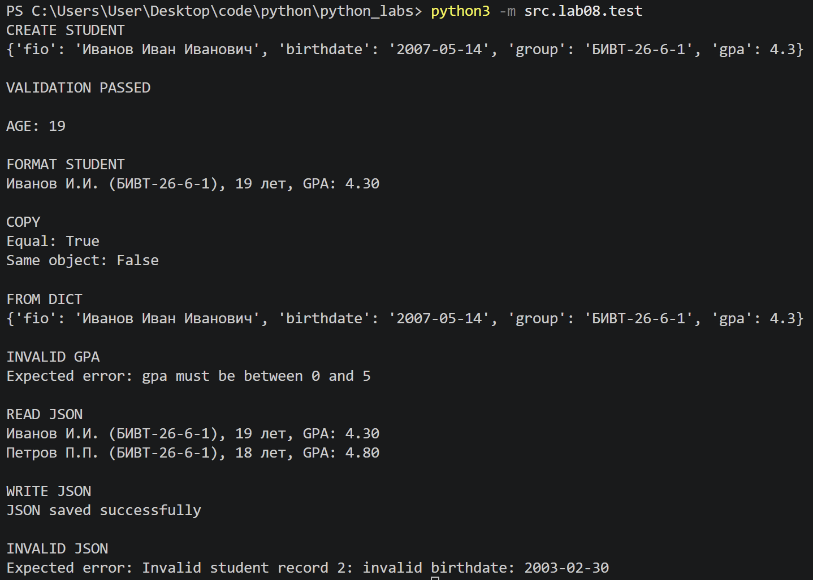
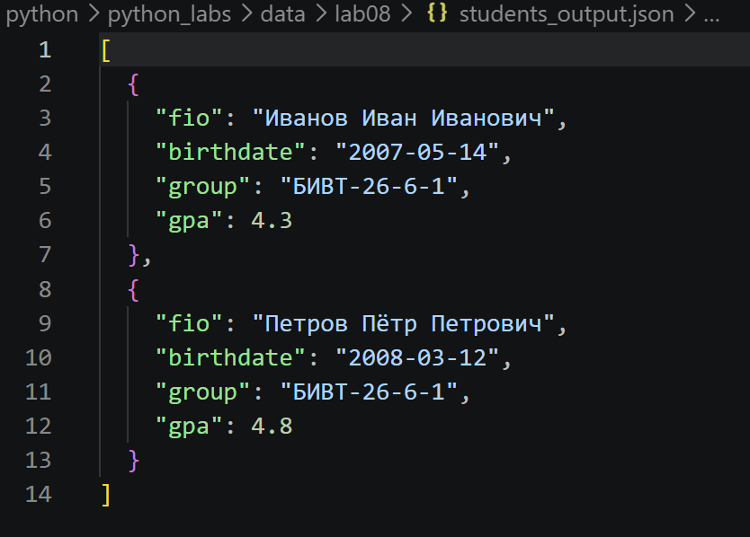
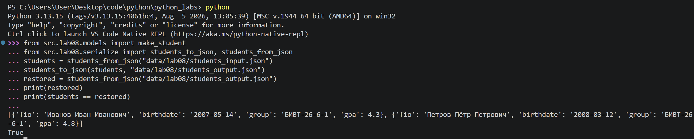
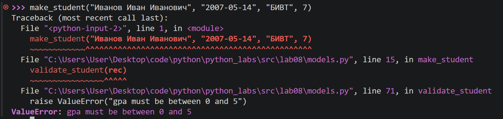
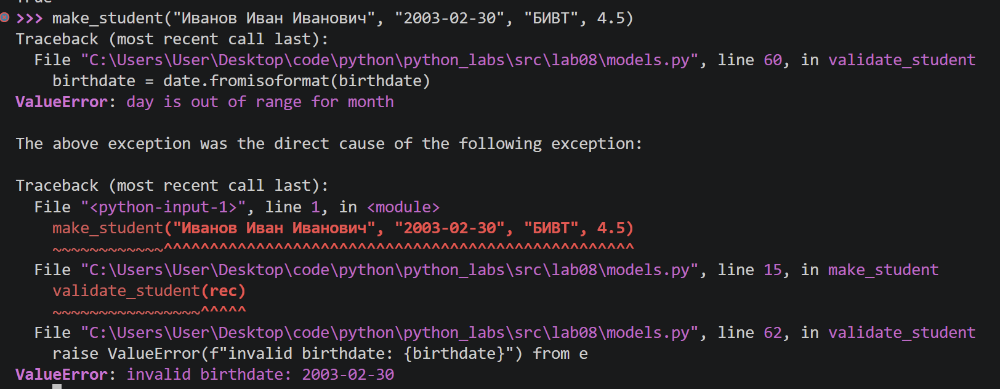
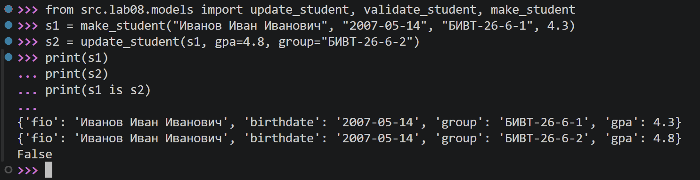
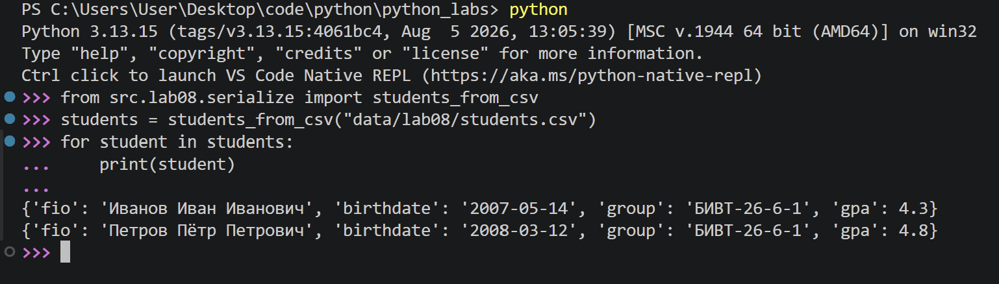

# ЛР8 – Модель данных без классов: запись Student как словарь, валидация и сериализация
## Поля:
| Поле | Тип данных | Описание |
|---|---|---|
| `fio` | `str` | ФИО студента, непустая строка |
| `birthdate` | `str` | Дата рождения в формате `YYYY-MM-DD`, не в будущем |
| `group` | `str` | Название учебной группы, непустая строка |
| `gpa` | `float` | Средний балл от 0 до 5 |

## Задание A - models.py
### imports
```py
from datetime import date
import re
```

### make_student
Функция создаёт словарь с данными студента, проверяет их корректность с помощью validate_student() и возвращает запись.
```py
def make_student(fio, birthdate, group, gpa) -> dict:
    """Create and return a student record with validated data."""
    rec = {
        "fio": fio,
        "birthdate": birthdate,
        "group": group,
        "gpa": gpa
    }

    validate_student(rec)
    rec["gpa"] = float(rec["gpa"])
    
    return rec
```

### validate_student
Функция проверяет точное соответствие ключей `STUDENT_FIELDS`, типы данных, непустоту строк `fio` и `group`, корректность даты рождения и диапазон GPA от 0 до 5.
Формат даты проверяется через `re.fullmatch()`, её существование — через `date.fromisoformat()`. Дата не должна находиться в будущем, а GPA не может иметь тип `bool`.
При некорректных данных вызывается исключение.
```py
def validate_student(rec) -> None:
    """
    Check the student record's fields, types, and values.
    Raise an exception if any data is invalid.
    """
    if not isinstance(rec, dict):
        raise ValueError("not a dict")
    
    keys = set(rec.keys())
    required_keys = set(STUDENT_FIELDS)

    # keys checking
    if keys != required_keys:
        missing = required_keys - keys
        extra = keys - required_keys
        raise ValueError(f"invalid keys: missing {missing}, extra {extra}")

    fio, group, birthdate, gpa = rec["fio"], rec["group"], rec["birthdate"], rec["gpa"]

    #fio checking
    if not isinstance(fio, str):
        raise TypeError("fio must be a string")
    if not fio.strip():
        raise ValueError("fio must not be empty")
    fio_list = [part for part in fio.split()]
    if not 2 <= len(fio_list) <= 3:
        raise ValueError("fio must contain 2 or 3 parts")

    # group checking
    if not isinstance(group, str):
            raise TypeError("group must be a string")
    if not group.strip():
        raise ValueError("group must not be empty")
        
    # birthdate checking
    if not isinstance(birthdate, str):
        raise TypeError("birthdate must be a string")
    if not re.fullmatch(r"[0-9]{4}-[0-9]{2}-[0-9]{2}", birthdate):
        raise ValueError("birthdate must be in YYYY-MM-DD format")
    try:
        birthdate = date.fromisoformat(birthdate)
    except ValueError as e:
        raise ValueError(f"invalid birthdate: {birthdate}") from e
    if birthdate > date.today():
        raise ValueError("birthdate cannot be in the future")

    # gpa checking
    gpa = rec["gpa"]
    if not isinstance(gpa, (int, float)) or isinstance(gpa, bool):
        raise TypeError("gpa must be a number")
    if not (0 <= gpa <= 5):
        raise ValueError("gpa must be between 0 and 5")
```

### student_age
Функция вычисляет полный возраст студента по дате рождения, учитывая, наступил ли день рождения в текущем году. Возвращает возраст в годах.
```py
def student_age(rec, today=None) -> int:
    """
    Calculate the student's full age as of the given date.
    Use the current date if no date is provided.
    """
    validate_student(rec)
    birthdate = date.fromisoformat(rec["birthdate"])

    if isinstance(today, str):
        today = date.fromisoformat(today)
    elif today is None:
        today = date.today()
    elif not isinstance(today, date):
        raise ValueError("today must be a date, string or None")
    age = today.year - birthdate.year
    if (today.month, today.day) < (birthdate.month, birthdate.day):
        age -= 1

    return age
```

### format_student
Функция преобразует ФИО в фамилию с инициалами, форматирует группу и GPA, вычисляет возраст. Возвращает строку с данными студента с учётом склонения «год/года/лет».
```py
def format_student(rec):
    """Return a formatted string with the student's name, group, age, and GPA."""
    validate_student(rec)

    fio, group, gpa = rec["fio"], rec["group"], rec["gpa"]

    fio_list = list(fio.split())
    name = f"{fio_list[0].capitalize()} {"".join(f"{x[0].upper()}." for x in fio_list[1:])}"

    group = f"({group.strip().upper()})"

    age = student_age(rec)

    gpa = f"{gpa:.2f}"

    if age % 100 in (11, 12, 13, 14):
        ending = 'лет'
    elif age % 10 == 1:
        ending = 'год'
    elif age % 10 in (2, 3, 4):
        ending = 'года'
    else:
        ending = 'лет'

    rec_f = f"{name} {group}, {age} {ending}, GPA: {gpa}"

    return rec_f 
```

### student_to_dict
Функция создаёт новый словарь с полями студента и возвращает независимую копию записи.
```py
def student_to_dict(rec):
    """Return an independent dictionary copy of a student record."""
    validate_student(rec)
    new_rec = {
        "fio": rec["fio"],
        "birthdate": rec["birthdate"],
        "group": rec["group"],
        "gpa": rec["gpa"]
    }

    return new_rec
```

### student_from_dict
Функция проверяет данные словаря, преобразует GPA в float и создаёт запись студента с помощью make_student().
```py
def student_from_dict(d):
    """
    Create a student record from a dictionary.
    Validate the data and convert GPA to float.
    """
    
    if not isinstance(d, dict):
        raise ValueError("not a dict")
    if set(d.keys()) != set(STUDENT_FIELDS):
        raise ValueError(f"invalid keys: {set(d.keys())} != {set(STUDENT_FIELDS)}")

    raw_gpa = d["gpa"]

    if isinstance(raw_gpa, bool):
        raise ValueError("gpa must not be bool")
    try:
        gpa = float(raw_gpa)
    except (ValueError, TypeError) as e:
        raise ValueError(f"gpa must be a number, got {raw_gpa}") from e

    d_student = make_student(d["fio"], d["birthdate"], d["group"], gpa)

    return d_student
```

### update_student
Функция создаёт копию записи студента, обновляет указанные поля и проверяет корректность новых данных. Исходная запись остаётся неизменной. При неизвестном поле вызывается KeyError, при некорректном значении — ValueError.
```py
def update_student(rec, **fields):
    """Return a new student record with updated fields."""
    validate_student(rec)

    for key in fields:
        if  key not in STUDENT_FIELDS:
            raise KeyError(f"unknown key provided: {key}")

    new_rec = rec.copy()
    new_rec.update(fields)

    validate_student(new_rec)
    return new_rec
```


## Задание B - serialize.py
### imports
```py
import json
from src.lab08.models import student_to_dict, student_from_dict
```

### students_to_json
Функция преобразует список студентов в список словарей и сохраняет его в JSON-файл с отступами и поддержкой кириллицы.
```py
def students_to_json(students, path):
    """Save a list of validated student records to a JSON file."""
    data = [student_to_dict(s) for s in students]

    with open(path, "w", encoding="utf-8") as file:
        json.dump(data, file, ensure_ascii=False, indent=2)
```

### students_from_json
Функция считывает JSON-файл, проверяет его структуру и последовательно восстанавливает записи студентов. При некорректных данных вызывает ValueError с номером записи.
```py
def students_from_json(path):
    """
    Load and validate student records from a JSON file.
    Raise ValueError with the record number if any data is invalid.
    """
    with open(path, "r", encoding="utf-8") as file:
        data = json.load(file)

    if not isinstance(data, list):
        raise ValueError("JSON root must be an array")

    students = []

    for index, record in enumerate(data, start = 1):
        try:
            student = student_from_dict(record)
        except ValueError as e:
            raise ValueError(f"Invalid student record {index}: {e}") from e

        students.append(student)

    return students
```
### Обработка некорректных записей

При чтении JSON используется политика `strict`. Каждая запись проверяется через `student_from_dict()`.
Если запись содержит некорректные данные, загрузка прекращается и вызывается `ValueError` с номером ошибочной записи и причиной ошибки.
Такая политика предотвращает загрузку некорректных данных без уведомления пользователя.

### students_from_csv
Функция считывает данные студентов из CSV-файла с помощью csv.DictReader(), преобразует GPA из строки в float через student_from_dict() и возвращает список проверенных записей. При некорректных данных вызывает ValueError с номером записи.
```py
def students_from_csv(path):
    students = []
    with open(path, "r", encoding="utf-8", newline="") as file:
        reader = csv.DictReader(file)

        for i, row in enumerate(reader, start = 1):
            try:
                students.append(student_from_dict(row))
            except (ValueError, TypeError) as e:
                raise ValueError(f"invalid rec {i}: {e}") from e
    return students
```

## results

### students_input.json
```json
[
  {
    "fio": "Иванов Иван Иванович",
    "birthdate": "2007-05-14",
    "group": "БИВТ-26-6-1",
    "gpa": 4.3
  },
  {
    "fio": "Петров Пётр Петрович",
    "birthdate": "2008-03-12",
    "group": "БИВТ-26-6-1",
    "gpa": 4.8
  }
]
``` 

### test.py
Файл test.py предназначен для проверки функций из models.py и serialize.py. Он позволяет последовательно проверить создание, валидацию, форматирование и копирование записей, а также сохранение и загрузку JSON без необходимости запускать каждую функцию отдельно через терминал.

Результаты проверок выводятся в консоль с соответствующими заголовками для удобства чтения.

**Результат**


### students_output.json


### json check


### bad gpa check


### invalid birthdate check


### update check


### from csv
input:
```
fio,birthdate,group,gpa
Иванов Иван Иванович,2007-05-14,БИВТ-26-6-1,4.3
Петров Пётр Петрович,2008-03-12,БИВТ-26-6-1,4.8
```
**result**
