# ЛР9 — «База данных» на CSV: CRUD-функции над students.csv и CLI
## Задание A - group.py
### imports
```py
from pathlib import Path
import csv

from src.lab08.models import student_from_dict, validate_student, STUDENT_FIELDS   
```

**UTILITY FUNCTIONS**

### ensure_storage
Функция проверяет наличие CSV-файла. Если файл отсутствует, создаёт необходимые каталоги и CSV с заголовком.
```py
def ensure_storage(path):
    """Create a CSV storage file with a header if it does not exist."""
    path = Path(path)

    if path.exists():
        return

    path.parent.mkdir(parents=True, exist_ok=True)
    with open(path, "w", encoding="utf-8", newline="") as file:
        writer = csv.DictWriter(file, fieldnames=STUDENT_FIELDS)
        writer.writeheader()
```

### load_students
Функция считывает записи студентов из CSV, проверяет их корректность и возвращает список словарей.
```py
def load_students(path) -> list[dict]:
    """Load and validate student records from a CSV file."""
    ensure_storage(path)

    with open(path, "r", encoding="utf-8", newline="") as file:
        reader = csv.DictReader(file)

        if reader.fieldnames is None:
            raise ValueError(f"file {path} must contain fieldnames")
        if tuple(reader.fieldnames) != STUDENT_FIELDS:
            raise ValueError(f"file {path} contains invalid fieldnames")

        students = []

        for number, row in enumerate(reader, start = 2):
            if None in row or None in row.values():
                raise ValueError(f"file {path} contains invalid data in line {number}: {row}")

            try:
                students.append(student_from_dict(row))
            except (ValueError, TypeError) as e:
                raise ValueError(f"It is impossible to load line {number}: {row}. Error: {e}") from e 

    return students 
```

### save_students
Функция проверяет записи студентов и перезаписывает CSV-файл переданными данными.
```py
def save_students(path, students):
    """Validate and save student records to a CSV file."""
    path = Path(path)
    ensure_storage(path)

    for student in students:
        validate_student(student)

    with open(path, "w", encoding="utf-8", newline="") as file:
        writer = csv.DictWriter(file, fieldnames=STUDENT_FIELDS)
        writer.writeheader()
        writer.writerows(students)
```

**CRUD FUNCTIONS**

### add_student
Функция проверяет новую запись студента, добавляет её к существующим и сохраняет обновлённый список в CSV.
```py
def add_student(path, student):
    """Add a new student to the CSV storage."""
    validate_student(student)

    students = load_students(path)
    students.append(dict(student))
    save_students(path, students)
```

### list_students
Функция возвращает список студентов в исходном порядке или сортирует его по ФИО либо GPA. При недопустимом параметре сортировки вызывает ValueError.
```py
def list_students(path, sort_by=None):
    """Return students optionally sorted by fio or gpa."""
    if sort_by not in (None, "fio", "gpa"):
            raise ValueError(f"{sort_by} is unknown sorting")
    
    students = load_students(path)

    if sort_by == "fio":
        return sorted(students, key=lambda s: s["fio"])
    if sort_by == "gpa":
        return sorted(students, key=lambda s: s["gpa"])
    
    return students
```

### find_students
Функция ищет студентов по подстроке в ФИО без учёта регистра. Возвращает список найденных записей или пустой список.
```py
def find_students(path, substr):
    """Find students by a case-insensitive fio substring."""
    students = load_students(path)

    needle = substr.casefold()
    return [student for student in students 
            if needle in student["fio"].casefold()
            ]
```

### remove_student
Функция удаляет все записи студентов с указанным ФИО, сохраняет изменения в CSV и возвращает количество удалённых записей.
```py
def remove_student(path, fio):
    """Remove all students with the given fio and return their count."""
    students = load_students(path)

    remaining = [student for student in students 
                 if student["fio"] != fio
                 ]
    removed_num = len(students) - len(remaining)

    if removed_num > 0:
        save_students(path, remaining)
    return removed_num
```

### update_student
Функция находит первую запись с указанным ФИО, изменяет переданные поля и сохраняет результат. Возвращает True при успешном обновлении и False, если студент не найден.
```py
def update_student(path, fio, **fields):
    """Update the first matching student record and return success status."""
    for key in fields:
        if key not in STUDENT_FIELDS:
            raise KeyError(f"unknown field '{key}'")

    students = load_students(path)
    for s_number, student in enumerate(students):
        if student["fio"] == fio:
            updated = dict(student)
            updated.update(fields)
            validate_student(updated)

            students[s_number] = updated
            save_students(path, students)
            return True
    return False
```

## Задание B - cli_students.py
### imports
```py
import argparse
import sys

from src.lab08.models import make_student, format_student
from src.lab09.group import (
    add_student,
    list_students,
    find_students,
    remove_student,
    update_student,
)
```

### build_parser
Функция создаёт парсер командной строки, настраивает общий аргумент --db и подкоманды для управления студентами.
```py
def build_parser():
    parser = argparse.ArgumentParser(description="CSV student storage")
    parser.add_argument("--db", default="data/lab09/students.csv", help="Path to the CSV file")
        
    sub = parser.add_subparsers(dest="command", required=True)

    add_parser = sub.add_parser("add", help="Add a new student.")
    add_parser.add_argument("--fio", required=True, help="Student's full name.")
    add_parser.add_argument("--birthdate", required=True, help="Birthdate in YYYY-MM-DD format.")
    add_parser.add_argument("--group", required=True, help="Student's group.")
    add_parser.add_argument("--gpa", required=True, help="Student's GPA (0-5).")

    list_parser = sub.add_parser("list", help="List all students.")
    list_parser.add_argument("--sort", choices=("fio", "gpa"), help="Sort students by fio or gpa.")
    
    find_parser = sub.add_parser("find", help="Find students by name.")
    find_parser.add_argument("--q", required=True, help="Name substring to search for.")

    remove_parser = sub.add_parser("remove", help="Remove students by name.")
    remove_parser.add_argument("--fio", required=True, help="Student's full name.")

    update_parser = sub.add_parser("update", help="Update a student record.")
    update_parser.add_argument("--fio", required=True, help="Student's full name.")
    update_parser.add_argument("--gpa", help="Student's GPA (0-5).")
    update_parser.add_argument("--group", help="Student's group.")
    update_parser.add_argument("--birthdate", help="Birthdate in YYYY-MM-DD format.")

    return parser
```

### main()
Функция обрабатывает аргументы командной строки, выполняет выбранную операцию и выводит результат. Возвращает код завершения программы.
```py
def main():
    parser = build_parser()
    args = parser.parse_args()

    try:
        if args.command == "add":
            student = make_student(
                args.fio,
                args.birthdate, 
                args.group,
                gpa=float(args.gpa)
            )
            add_student(args.db, student)
            print("student added")

        elif args.command == "list":
            students = list_students(args.db, args.sort)
            for student in students:
                print(format_student(student))

        elif args.command == "find":
            found = find_students(args.db, args.q)
            if found:
                for student in found:
                    print(format_student(student))
            else:
                print("student not found")

        elif args.command == "remove":
            count = remove_student(args.db, args.fio)
            print(f"{count} records were removed")

        elif args.command == "update":
            fields = {}

            if args.gpa is not None:
                fields["gpa"] = float(args.gpa)
            if args.group is not None:
                fields["group"] = args.group
            if args.birthdate is not None:
                fields["birthdate"] = args.birthdate

            found = update_student(args.db, args.fio, **fields)

            if found:
                print("record updated")
            else:
                print("student not found")
        
    except (ValueError, TypeError, KeyError) as er:
        print(f"Error: {er}", file=sys.stderr)
        return 1
    return 0

if __name__ == "__main__":
    sys.exit(main())
```

## results

Для проверки программы использовались два CSV-файла:
- `data/lab09/students_good.csv` — корректные данные.
```
fio,birthdate,group,gpa
Иванов Иван Иванович,2007-10-10,БИВТ-26-6-1,4.3
Петров Пётр Петрович,2007-05-15,БИВТ-26-6-2,4.8
Сидорова Анна Сергеевна,2008-01-20,БИВТ-26-6-1,3.7
Иванов Иван Иванович,2007-10-10,БИВТ-26-6-2,4.1
Кузнецов Максим Олегович,2007-12-01,БИВТ-26-6-3,5.0
Орлова Мария Ивановна,2008-04-22,БИВТ-26-6-2,2.9
```
- `data/lab09/students_bad.csv` — некорректный заголовок.
```
fio,birthdate,group,gpa,extra
Иванов Иван Иванович,2007-10-10,БИВТ-26-6-1,4.3,test
```


### Сценарий работы программы

| Операция | Скриншот |
|---|---|
| Просмотр списка студентов | 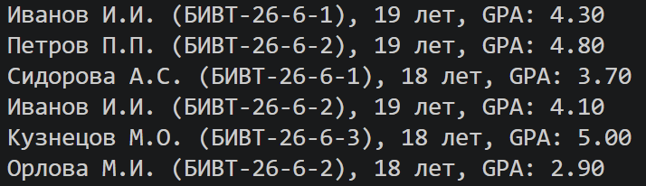 |
| Поиск студента | 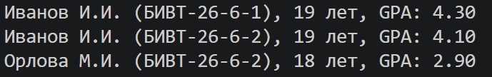 |
| Добавление студента | 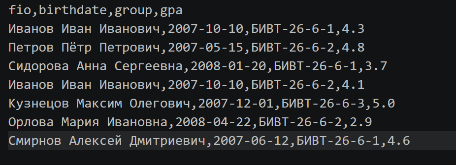 |
| Обновление GPA | 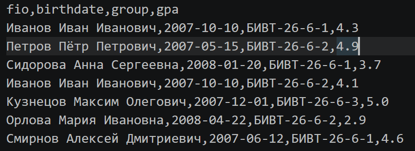 |
| Удаление студентов | 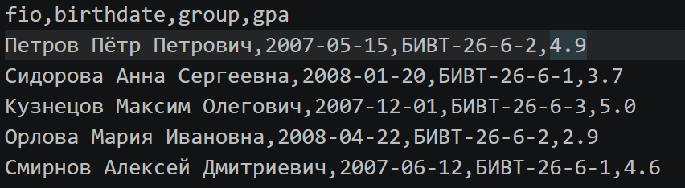 |
| Просмотр итогового списка | 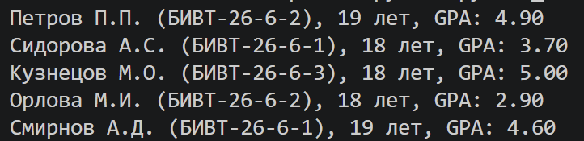 |


### Проверка корректных данных

| № | Проверка | Команда запуска | Скриншот |
|---|---|---|---|
| 1 | Чтение всех студентов | `python -m src.lab09.cli_students --db data/lab09/students_good.csv list` |  |
| 2 | Сортировка по GPA | `python -m src.lab09.cli_students --db data/lab09/students_good.csv list --sort gpa` | 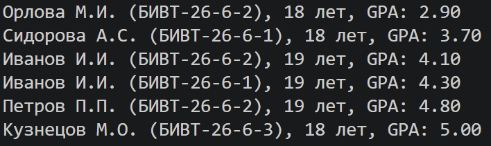 |
| 3 | Сортировка по ФИО | `python -m src.lab09.cli_students --db data/lab09/students_good.csv list --sort fio` | 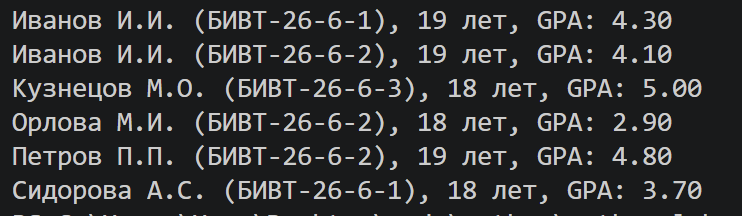 |
| 4 | Поиск без учёта регистра | `python -m src.lab09.cli_students --db data/lab09/students_good.csv find --q ИВАН` |  |
| 5 | Поиск отсутствующего студента | `python -m src.lab09.cli_students --db data/lab09/students_good.csv find --q Смирнов` | 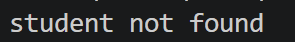 |
| 6 | Добавление студента | `python -m src.lab09.cli_students --db data/lab09/students_good.csv add --fio "Смирнов Алексей Дмитриевич" --birthdate 2007-06-12 --group БИВТ-26-6-1 --gpa 4.6` |  |
| 7 | Обновление GPA | `python -m src.lab09.cli_students --db data/lab09/students_good.csv update --fio "Петров Пётр Петрович" --gpa 4.9` |  |
| 8 | Обновление первой записи с совпадающим ФИО | `python -m src.lab09.cli_students --db data/lab09/students_good.csv update --fio "Иванов Иван Иванович" --gpa 3.5` | 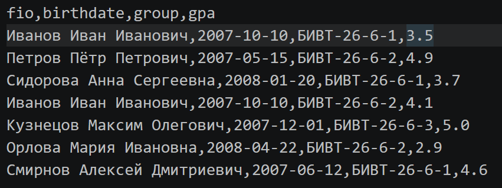 |
| 9 | Удаление отсутствующего студента | `python -m src.lab09.cli_students --db data/lab09/students_good.csv remove --fio "Васильев Олег"` | 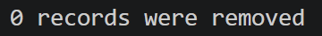 |
| 10 | Удаление всех записей с совпадающим ФИО | `python -m src.lab09.cli_students --db data/lab09/students_good.csv remove --fio "Иванов Иван Иванович"` |  |
| 11 | Проверка некорректного GPA | `python -m src.lab09.cli_students --db data/lab09/students_good.csv add --fio "Тестовый Студент" --birthdate 2007-04-10 --group БИВТ-26-6-1 --gpa 7` | 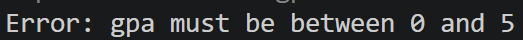 |
| 12 | Проверка некорректной даты | `python -m src.lab09.cli_students --db data/lab09/students_good.csv add --fio "Тестовый Студент" --birthdate 2007-02-30 --group БИВТ-26-6-1 --gpa 4.0` | 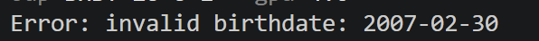 |
| 13 | Проверка итогового состояния CSV | `python -m src.lab09.cli_students --db data/lab09/students_good.csv list` |  |

### Проверка некорректного CSV

| № | Проверка | Команда запуска | Скриншот |
|---|---|---|---|
| 14 | Некорректный заголовок CSV | `python -m src.lab09.cli_students --db data/lab09/students_bad.csv list` | 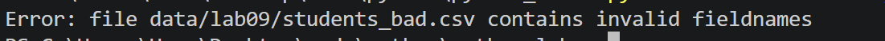 |

### Дополнительная проверка функций group.py

| № | Проверка | Команда запуска | Скриншот |
|---|---|---|---|
| 15 | Недопустимый ключ сортировки — ValueError | `python -c "from src.lab09.group import list_students; list_students('data/lab09/students_good.csv', 'age')"` | 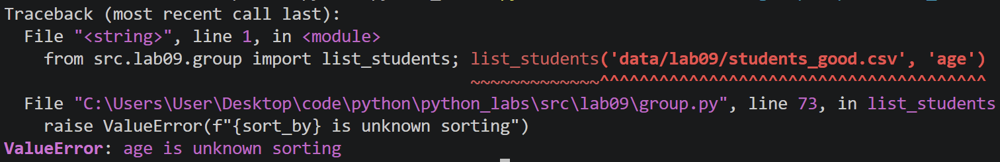 |
| 16 | Обновление отсутствующей записи — False | `python -c "from src.lab09.group import update_student; print(update_student('data/lab09/students_good.csv', 'Несуществующий Студент', gpa=4.5))"` | 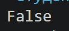 |
| 17 | Обновление неизвестного поля — KeyError | `python -c "from src.lab09.group import update_student; update_student('data/lab09/students_good.csv', 'Петров Пётр Петрович', course=2)"` | 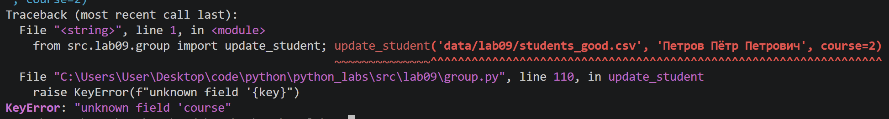 |

### Итоговый CSV:
```
fio,birthdate,group,gpa
Петров Пётр Петрович,2007-05-15,БИВТ-26-6-2,4.9
Сидорова Анна Сергеевна,2008-01-20,БИВТ-26-6-1,3.7
Кузнецов Максим Олегович,2007-12-01,БИВТ-26-6-3,5.0
Орлова Мария Ивановна,2008-04-22,БИВТ-26-6-2,2.9
Смирнов Алексей Дмитриевич,2007-06-12,БИВТ-26-6-1,4.6
```