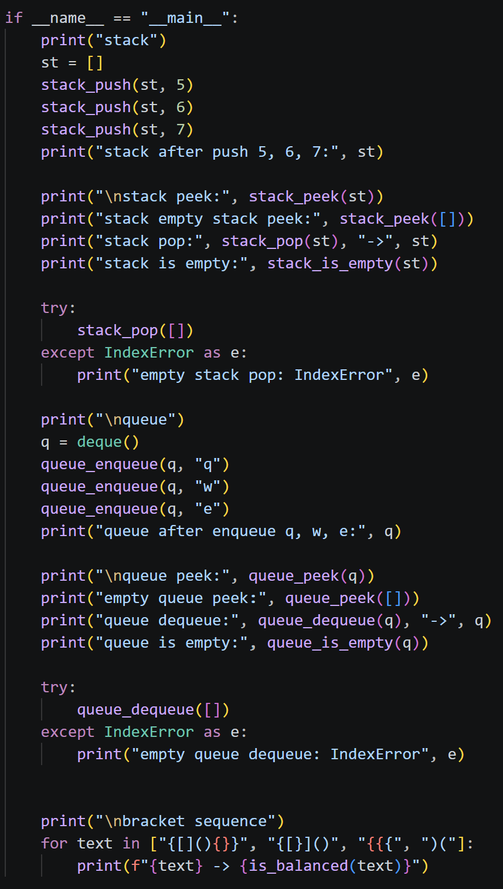
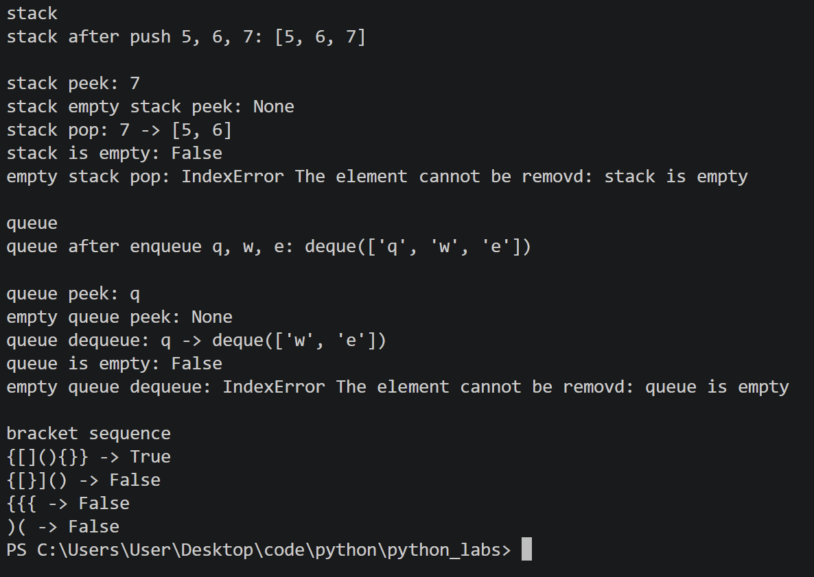
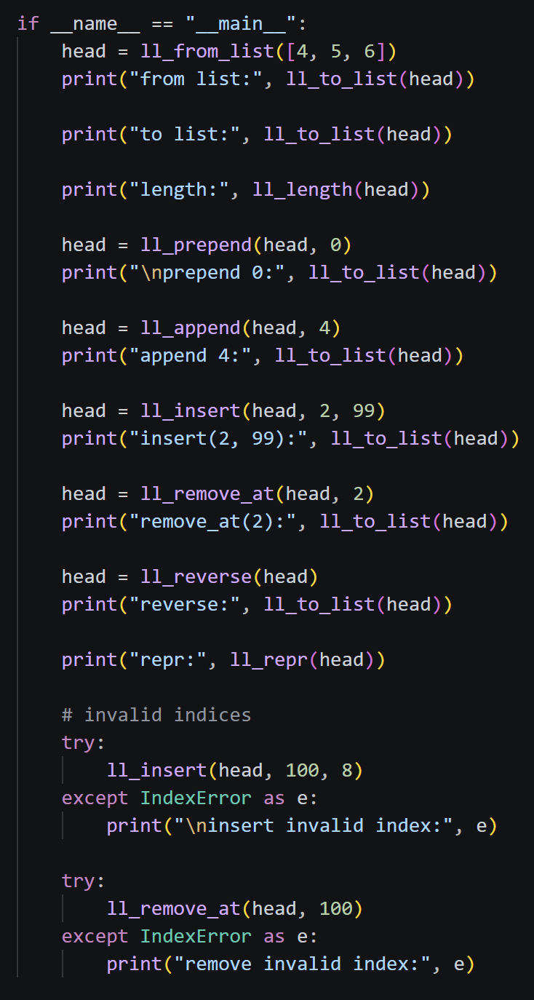
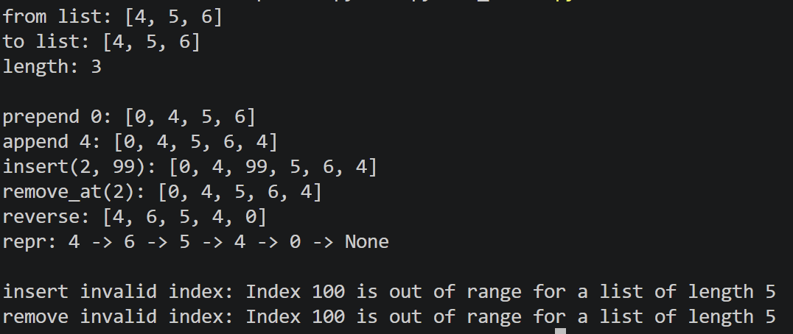
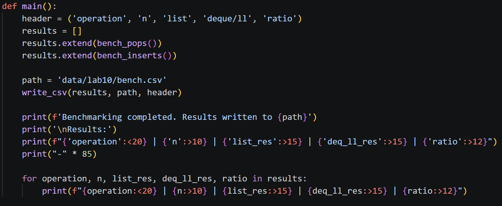
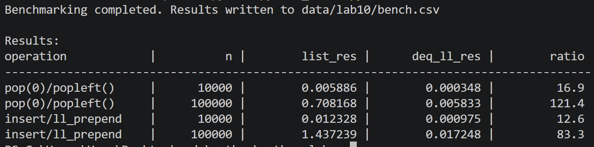

# ЛР10 — Структуры данных: Stack, Queue, Linked List и бенчмарки
## Теоретическая часть
**Стек** — структура данных, работающая по принципу LIFO (Last In, First Out): последний добавленный элемент извлекается первым.

| Операция | Описание | Сложность |
|---|---|---|
| `stack_push(st, item)` | Добавление элемента на вершину стека | O(1) |
| `stack_pop(st)` | Удаление и возвращение верхнего элемента | O(1) |
| `stack_peek(st)` | Получение верхнего элемента без удаления | O(1) |
| `stack_is_empty(st)` | Проверка стека на пустоту | O(1) |

**Очередь** — структура данных, работающая по принципу FIFO (First In, First Out): первый добавленный элемент извлекается первым.

| Операция | Описание | Сложность |
|---|---|---|
| `queue_enqueue(q, item)` | Добавление элемента в конец очереди | O(1) |
| `queue_dequeue(q)` | Удаление и возвращение первого элемента | O(1) |
| `queue_peek(q)` | Получение первого элемента без удаления | O(1) |
| `queue_is_empty(q)` | Проверка очереди на пустоту | O(1) |

**Односвязный список** — структура данных, состоящая из узлов (Node), каждый из которых хранит значение (value) и ссылку на следующий узел (next). В отличие от встроенного списка Python, односвязный список не поддерживает прямой доступ к элементу по индексу. Для поиска нужного узла требуется последовательно пройти по ссылкам.

| Операция | Описание | Сложность |
|---|---|---|
| `ll_from_list(values)` | Создание связного списка из последовательности | O(n) |
| `ll_to_list(head)` | Преобразование связного списка в `list` | O(n) |
| `ll_length(head)` | Подсчёт количества узлов | O(n) |
| `ll_prepend(head, value)` | Добавление узла в начало | O(1) |
| `ll_append(head, value)` | Добавление узла в конец | O(n) |
| `ll_insert(head, idx, value)` | Вставка узла по индексу | O(n) |
| `ll_remove_at(head, idx)` | Удаление узла по индексу | O(n) |
| `ll_reverse(head)` | Разворот списка | O(n) |
| `ll_repr(head)` | Формирование строкового представления | O(n) |

## Задание A - structures.py

Стек реализован с помощью функций над `list`: `stack_push(st, item)` добавляет элемент на вершину, `stack_pop(st)` удаляет и возвращает верхний элемент (если стек пуст — `IndexError`), `stack_peek(st)` возвращает верхний элемент без удаления (если стек пуст — `None`), `stack_is_empty(st)` проверяет, пуст ли стек.

Очередь реализована с помощью функций над `deque`: `queue_enqueue(q, item)` добавляет элемент в конец, `queue_dequeue(q)` удаляет и возвращает первый элемент (если очередь пуста — `IndexError`), `queue_peek(q)` возвращает первый элемент без удаления (если очередь пуста — `None`), `queue_is_empty(q)` проверяет, пуста ли очередь.

Функция `is_balanced(s)` проверяет правильность расстановки скобок `()`, `[]`, `{}` с использованием стека. При встрече открывающей скобки она добавляется в стек, а при встрече закрывающей проверяется соответствие последней открывающей скобке. Если скобки не совпадают или стек пуст, функция возвращает `False`. После обработки всей строки стек также должен быть пустым. Остальные символы игнорируются. 

### results:
```bash
python -m src.lab10.structures
```
| | |
|:------:|:-----:|
| | |

## Задание B - linked_list.py

Функция `ll_from_list(values)` создаёт односвязный список из обычного списка Python, сохраняя порядок элементов, `ll_to_list(head)` преобразует связный список обратно в обычный список, а `ll_length(head)` возвращает количество узлов.

Функция `ll_prepend(head, value)` добавляет новый узел в начало списка, `ll_append(head, value)` — в конец, `ll_insert(head, idx, value)` вставляет узел по указанному индексу, а `ll_remove_at(head, idx)` удаляет узел по индексу. При недопустимом индексе `ll_insert` и `ll_remove_at` вызывают `IndexError`. Все эти функции возвращают голову обновлённого списка.

Функция `ll_reverse(head)` разворачивает список, изменяя ссылки между существующими узлами, и возвращает новую голову. Функция `ll_repr(head)` возвращает строковое представление списка в виде цепочки значений.

### results:
```bash
python -m src.lab10.linked_list
```
| | |
|:------:|:-----:|
| | |

## Задание C - bench.py
### bench_pops
```py
def bench_pops():
    """
    Compare the execution times of list.pop(0) and deque.popleft()
    Return benchmark results for different sizes
    """
    result_pop = []

    for n in (10_000, 100_000):
        num_list = list(range(n))
        num_q = deque(range(n))

        list_time_p = timeit.timeit(lambda: num_list.pop(0), number = n)
        que_time_p = timeit.timeit(lambda: num_q.popleft(), number = n)

        result_pop.append(['pop(0)/popleft()', n, f'{list_time_p:.6f}', f'{que_time_p:.6f}', f'{list_time_p / que_time_p:.1f}'])
        
    return result_pop
```

### bench_inserts
```py
def bench_inserts():
    """
    Compare the execution times of list.insert(0, x) and ll_prepend()
    Return benchmark results for different sizes
    """
    result_insert = []

    for n in (10_000, 100_000):
        nums = []

        list_time_ins = timeit.timeit(lambda: nums.insert(0, 10), number = n)

        head = None 

        def ll_prep_op():
            """
            Prepend a node and update the linked list head
            """
            nonlocal head
            head = ll_prepend(head, 10)

        ll_time_ins = timeit.timeit(ll_prep_op, number = n)

        result_insert.append(['insert/ll_prepend', n, f'{list_time_ins:.6f}',  f'{ll_time_ins:.6f}', f'{list_time_ins / ll_time_ins:.1f}'])

    return result_insert
```
### results
```bash
python -m src.lab10.bench
```
 


### bench.csv

```
operation,n,list,deque/ll,ratio
pop(0)/popleft(),10000,0.005886,0.000348,16.9
pop(0)/popleft(),100000,0.708168,0.005833,121.4
insert/ll_prepend,10000,0.012328,0.000975,12.6
insert/ll_prepend,100000,1.437239,0.017248,83.3
```

### Выводы по бенчмаркам

**1. `list.pop(0)` и `deque.popleft()`**

`deque.popleft()` быстрее `list.pop(0)`, так как `list.pop(0)` имеет сложность O(n), поскольку после удаления первого элемента необходимо сдвигать остальные элементы списка. `deque.popleft()` выполняется за O(1), так как удаление первого элемента не требует сдвига остальных.

**2. `list.insert(0, x)` и `ll_prepend(head, x)`**

`ll_prepend()` быстрее `list.insert(0, x)`, так как `list.insert(0, x)` имеет сложность O(n), поскольку при вставке в начало необходимо сдвигать существующие элементы. `ll_prepend()` выполняется за O(1), так как достаточно создать новый узел и изменить ссылку на начало связного списка.
